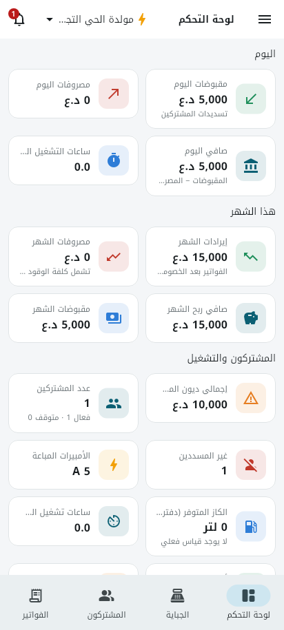

# Generator OS — نظام إدارة وتشغيل المولدات الأهلية

نظام تجاري متكامل لأصحاب المولدات الأهلية في العراق: المشتركون، الفواتير، الجباية، الجباة، الصندوق، المحاسبة بالقيد المزدوج، الوقود، الصيانة، الأعطال، الأحمال، الشكاوى، التقارير، والمساعد الذكي — **يعمل بالكامل دون إنترنت**، مع مزامنة اختيارية لعدة أجهزة.

[](https://github.com/ibrahim205b-tech/gghhjj/actions/workflows/build.yml)

---

| لوحة التحكم (هاتف) | شاشة الجابي | وصل حراري |
|---|---|---|
|  |  |  |

## المحتويات

| المجلد | الوصف |
|---|---|
| `packages/generator_core` | محرك النظام بلغة Dart الصافية: قاعدة البيانات والترحيلات، دفتر الأستاذ، الفواتير، الجباية، الوقود، التقارير، الصلاحيات، المزامنة، النسخ الاحتياطي، الترخيص، المساعد الذكي. |
| `app` | تطبيق أندرويد (Flutter) بواجهة عربية RTL للهاتف والتابلت. |
| `server` | خادم المزامنة وربط الأجهزة والتراخيص ولوحة إدارة المطور (Dart + SQLite). |
| `docs` | التوثيق: الخادم، بناء APK، الترخيص، الميزات، الاختبارات. |
| `.github/workflows/build.yml` | فحص الكود وتشغيل الاختبارات وبناء `generator-os-release.apk` تلقائياً. |

## لماذا هذه البنية؟

- **Flutter + Dart**: تطبيق أندرويد أصلي الأداء بواجهة واحدة للهاتف والتابلت، ودعم ممتاز للعربية واتجاه RTL.
- **محرك منفصل بلغة Dart الصافية** (`generator_core`): كل الحسابات المالية خارج الواجهة، فتُختبر آلياً على قاعدة SQLite حقيقية، ويستخدمها الخادم في اختبارات المزامنة الشاملة.
- **SQLite محلية (Offline-First)**: كل العمليات اليومية تعمل دون إنترنت؛ المزامنة إضافة اختيارية.
- **خادم Dart بسيط**: نفس اللغة، ملف تنفيذي واحد، قاعدة SQLite، يمكن تشغيله على أي VPS.

## مبادئ الدقة والأمان المطبقة فعلياً

- **قيد مزدوج حقيقي**: كل عملية مالية تولد قيداً متوازناً (مدين = دائن) مرتبطاً بمصدره؛ القيود غير المتوازنة مرفوضة.
- **لا حذف ولا تعديل للسجلات المالية**: القيود والدفعات والفواتير وسجل التدقيق محمية بـ Triggers داخل قاعدة البيانات نفسها؛ التصحيح يتم بقيد عكسي موثق فقط.
- **المبالغ أعداد صحيحة بالدينار** والوقود بالمليلتر — لا أخطاء تقريب عشرية.
- **منع التكرار**: معرف الفاتورة مشتق من (المشترك + الشهر)، فيستحيل إصدار فاتورتين لنفس الشهر حتى من جهازين دون إنترنت. كل دفعة لها مفتاح منع تكرار (Idempotency Key).
- **حالة الفاتورة مشتقة من الدفتر** (مسددة/جزئية/غير مسددة) وليست عموداً قابلاً للتلاعب.
- **الصلاحيات تُفرض داخل المحرك** وليس في الواجهة فقط: الجابي لا يرى الأرباح ولا يعدل الأسعار ولا يلغي دفعة ولا يرى إلا مشتركي مناطقه.
- **كلمات المرور** مشفرة بـ PBKDF2-HMAC-SHA256 مع قفل مؤقت بعد 5 محاولات فاشلة وتنبيه أمني.
- **النسخ الاحتياطي مشفر** بـ AES-256-GCM بكلمة مرور.
- **الترخيص الدائم** موقع بـ Ed25519؛ لا ينتهي ولا يقفل البيانات أبداً.

## التشغيل محلياً (للمطور)

المتطلبات: Flutter 3.47 (يتضمن Dart)، Android SDK لبناء APK، و`libsqlite3` لتشغيل الاختبارات على لينكس.

```bash
# 1) المحرك
cd packages/generator_core && dart pub get && dart test

# 2) الخادم (يتضمن اختبار مزامنة شامل بين جهازين)
cd ../../server && dart pub get && dart test

# 3) التطبيق
cd ../app && flutter pub get && flutter test
flutter run                 # على هاتف موصول أو محاكي
flutter build apk --release # بناء APK
```

## تثبيت التطبيق على الهاتف أو التابلت

1. افتح صفحة [GitHub Actions](https://github.com/ibrahim205b-tech/gghhjj/actions/workflows/build.yml) واختر آخر تشغيل ناجح (✅).
2. من قسم **Artifacts** نزّل `generator-os-release` واستخرج الملف `generator-os-release.apk`.
3. انقل الملف للهاتف (واتساب/كيبل/Drive)، وافتحه، واسمح بـ **«التثبيت من مصادر غير معروفة»** عند الطلب.
4. عند أول تشغيل: أنشئ حساب المالك وأول مولدة. أو اختر **«استعادة نسخة احتياطية»** لنقل بياناتك من جهاز قديم.
5. يعمل على أندرويد 7.0 فأحدث (حسب الحد الأدنى في Flutter)، بالوضعين العمودي والأفقي، والهاتف والتابلت (تظهر قائمة جانبية على الشاشات العريضة).

> ⚠️ إذا لم تُضبط مفاتيح التوقيع في GitHub Secrets يكون الـ APK موقعاً بمفتاح Debug: صالح للتجربة والتثبيت، لكن **لا يصلح للنشر على Google Play**، ولا يمكن تحديثه فوق نسخة موقعة بمفتاح آخر. التفاصيل في [docs/BUILD_APK.md](docs/BUILD_APK.md).

## الاستخدام اليومي باختصار

1. **الإعدادات ← المولدات**: سعر الأمبير الافتراضي وحد تنبيه الكاز.
2. **الكابينات والأحمال**: أضف المناطق والكابينات (مع السعة القصوى) والخطوط.
3. **المشتركون**: أضف المشتركين (مع الدين السابق إن وجد).
4. **الفواتير**: «إصدار فواتير الشهر» ثم «إغلاق الشهر» بعد المراجعة.
5. **المستخدمون**: أنشئ حساب جابي، ثم **الجباة**: اربطه بسجل جابي وخصص له مناطق.
6. الجابي يسجل الدفعات ويصدر الوصولات دون إنترنت؛ **الجباة ← استلام المبالغ** ينقلها لعهدة الصندوق.
7. **الصندوق ← عدّ النقد وإغلاق اليوم**: يقارن النقد الفعلي بالمتوقع ويوثق أي فرق.
8. **الوقود / التشغيل والصيانة / الشكاوى / التقارير / المساعد الذكي**.

## التوثيق

- [docs/FEATURES.md](docs/FEATURES.md) — قائمة الميزات المنفذة فعلياً، وما يحتاج أجهزة أو خدمات خارجية، والمؤجل وسببه.
- [docs/BACKEND.md](docs/BACKEND.md) — إعداد خادم المزامنة ولوحة الإدارة وواجهة REST.
- [docs/BUILD_APK.md](docs/BUILD_APK.md) — بناء APK والتوقيع الآمن.
- [docs/LICENSING.md](docs/LICENSING.md) — نظام الترخيص الدائم وإصدار التراخيص.
- [docs/TESTING.md](docs/TESTING.md) — الاختبارات المنفذة ونتائجها وما يتطلب أجهزة فعلية.
- [docs/ARCHITECTURE.md](docs/ARCHITECTURE.md) — البنية وقاعدة البيانات ودليل الحسابات وقواعد القيود.
