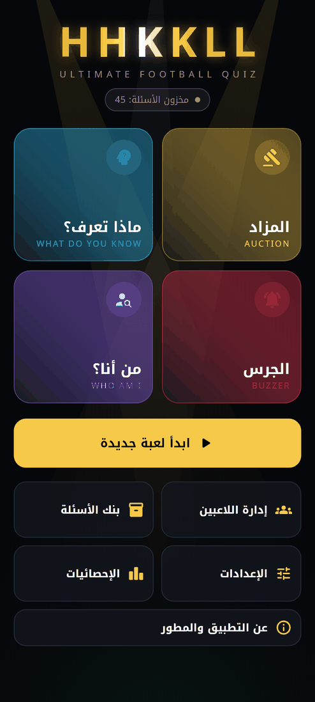
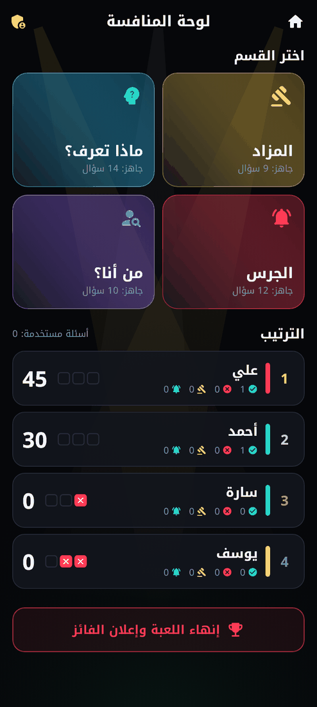
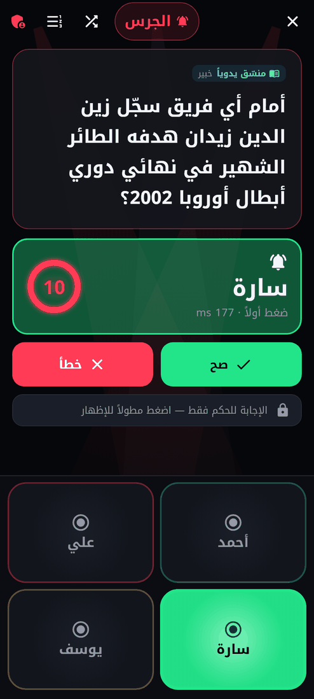
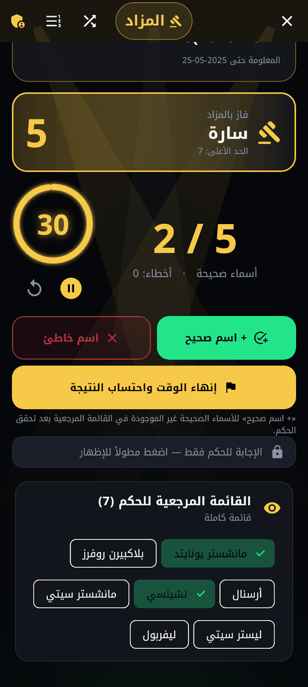
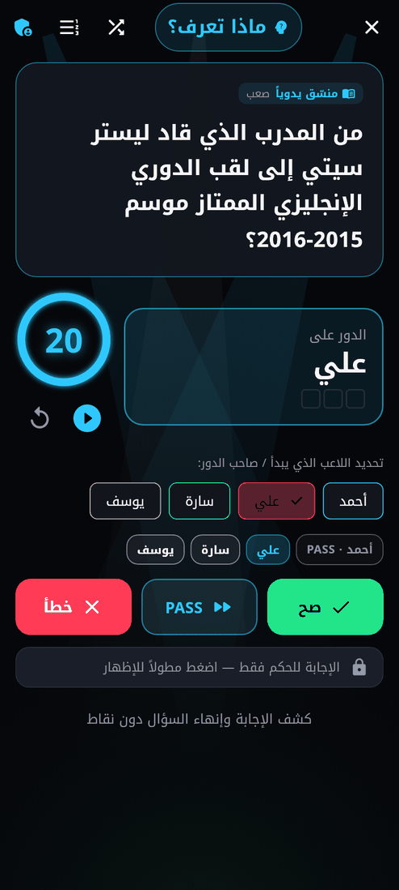
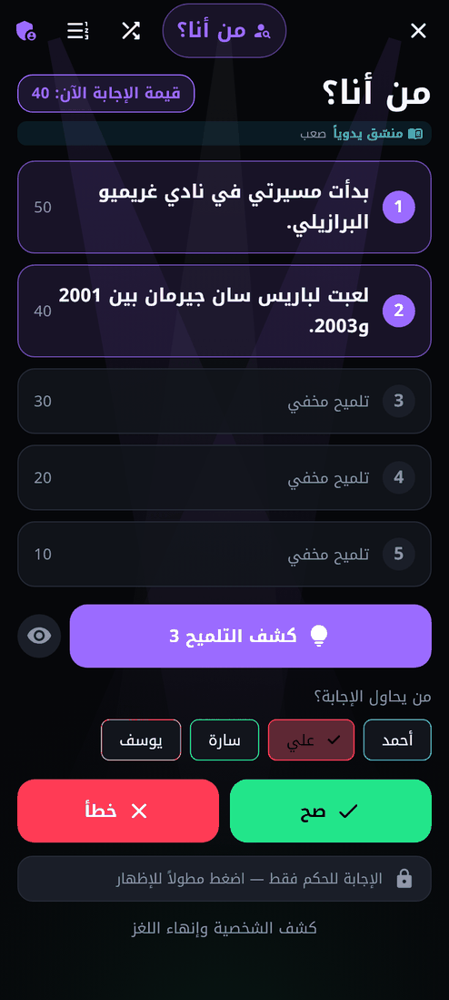
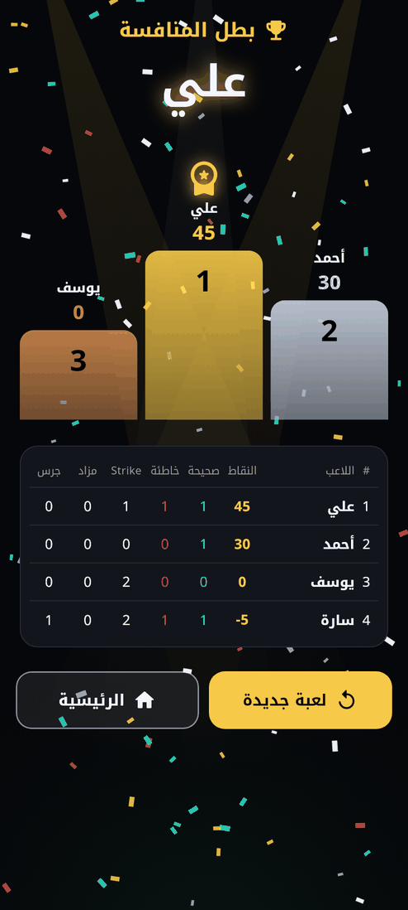

# HHKKLL — Ultimate Football Quiz

مسابقة كرة قدم بأسلوب البرامج التلفزيونية لأجهزة Android — أربعة أقسام، حكم يملك السيطرة الكاملة، وأسئلة تُولَّد عبر الإنترنت وتُتحقق منها ولا تتكرر داخل الجلسة.

> «المطور ابراهيم تاج راسكم» — «برمجة ابراهيم البو حطة»

[](https://github.com/ibrahim205b-tech/gghhjj/actions/workflows/hhkkll.yml)

| المقدمة | الرئيسية | لوحة المنافسة | الجرس |
|---|---|---|---|
|  |  |  |  |
| **المزاد** | **ماذا تعرف؟** | **من أنا؟** | **الفائز** |
|  |  |  |  |

اللقطات مُولّدة من الواجهة الحقيقية عبر `flutter test` (انظر «الاختبار»).

---

## التحميل والتثبيت

1. افتح صفحة [Actions › HHKKLL](https://github.com/ibrahim205b-tech/gghhjj/actions/workflows/hhkkll.yml) واختر آخر تشغيل ناجح ✅، ثم حمّل **HHKKLL-apk** من قسم Artifacts (يتطلب تسجيل الدخول إلى GitHub)،
   أو حمّل ملف APK من صفحة [Releases](https://github.com/ibrahim205b-tech/gghhjj/releases) إن وُجدت نسخة منشورة.
2. افتح الملف على الهاتف واسمح بـ«تثبيت التطبيقات من مصادر غير معروفة».
3. إن كانت نسخة سابقة مثبتة ولم تُضبط مفاتيح التوقيع (انظر أدناه) فاحذفها أولاً، لأن كل بناء موقّع بمفتاح تجريبي مختلف.

---

## بنية المشروع

| المجلد | المحتوى |
|---|---|
| `core/` | محرك اللعبة بلغة Dart الصافية: نموذج السؤال، البصمات النصية والدلالية، فهرس منع التكرار، الأقسام الأربعة كآلات حالة، النقاط والأخطاء والإقصاء، حفظ الجلسة، ونظام الإمداد التلقائي بالأسئلة. |
| `backend/` | خدمة توليد الأسئلة والتحقق منها (TypeScript + Anthropic SDK الرسمي): API للتطبيق، حدود تكلفة، وأمر CLI ينشر «الموجز» من GitHub Actions. |
| `app/` | تطبيق Android بـ Flutter (عربي RTL): المقدمة السينمائية، الواجهات، الأصوات، لوحة الحكم. |
| `content/seed_questions.json` | حزمة البداية المدمجة في التطبيق: **1182 سؤالاً** (المزاد 38، ماذا تعرف؟ 651، الجرس 424، من أنا؟ 69) مع رابط مرجعي لكل سؤال. تُبنى بـ `tools/build_pack.py` من `content/handwritten.json` وجداول الحقائق في `tools/pack_data.py`، ثم يفحصها محرك منع التكرار: `cd core && dart run tool/check_pack.dart --fix`. |
| `tools/` | سكربتات توليد المؤثرات الصوتية وأيقونة التطبيق (مُصنّعة برمجياً، بلا ملفات خارجية). |
| `.github/workflows/hhkkll.yml` | اختبارات ← بناء APK ← فحصه ← تثبيته وتشغيله على محاكي Android ← Release عند الطلب. |
| `.github/workflows/hhkkll-questions.yml` | توليد أسئلة جديدة يومياً ونشرها في فرع `hhkkll-feed` (يعمل فقط بعد إضافة مفتاح API). |

---

## نظام الأسئلة

### كيف تصل الأسئلة إلى اللعبة
عند بدء منافسة جديدة يطلب التطبيق تلقائياً دفعة جديدة لكل قسم من المصادر المتاحة بالترتيب:
1. **خادم التوليد** (`backend/`): يولّد عند الطلب. عندما يقترب عميل من نفاد الأسئلة غير المستخدمة يبدأ الخادم دفعة جديدة في الخلفية.
2. **الموجز المنشور** (فرع `hhkkll-feed`): يحدّثه workflow مجدول؛ لا يحتاج استضافة خادم.
3. **حزمة البداية المدمجة** (1182 سؤالاً) والمخزون المحلي لكل ما وصل سابقاً.

كلما انخفض عدد الأسئلة الجاهزة في قسم إلى 4 يُطلب المزيد تلقائياً، دون أي زر من الحكم. عند انقطاع الإنترنت يستمر اللعب من المخزون المحلي، وتُعاد المحاولة تلقائياً بمهلة متزايدة (2، 4، 8… حتى 60 ثانية) إلى أن يعود الاتصال.

### التحقق (ما يحدث فعلاً)
كل دفعة تمر بمرحلتين منفصلتين:
1. **التوليد**: النموذج يبحث على الويب (`web_search`) ويكتب الأسئلة مع المصادر.
2. **التحقق المستقل**: طلب منفصل لا يرى استدلال المولّد، يبحث ويفتح الصفحات المذكورة (`web_fetch`) ويحكم على كل سؤال.

لا يُقبل السؤال إلا إذا:
- كان مصدره المذكور من الصفحات التي **استرجعها المولّد فعلاً** (أي رابط مخترع يُرفض آلياً)،
- وحكم عليه المدقق بـ `verified`، وكانت روابط أدلته من الصفحات التي **استرجعها المدقق فعلاً**،
- وفي المزاد: تأكد المدقق من كل عناصر القائمة،
- ولم يكن مكرراً لأي سؤال في المخزون.

يحمل السؤال المقبول `verification.status = "verified"` واسم النموذج ووقت التحقق والروابط. أسئلة حزمة البداية تحمل `"curated"` (مكتوبة يدوياً بمعلومات تاريخية ثابتة مع رابط مرجعي)، ولا يدّعي التطبيق أنها مُتحقق منها آلياً، ويظهر ذلك للحكم بشارة مختلفة.

**كيف بُنيت حزمة البداية:** 45 سؤالاً مكتوبة يدوياً، والباقي مشتق من جداول حقائق تاريخية منتهية: نهائيات كأس العالم (1930–2022) وأمم أوروبا ودوري الأبطال (1956–2025)، والكرة الذهبية (1956–2025)، وأبطال الدوريات الخمسة الكبرى، وكأس أفريقيا وآسيا وكوبا أمريكا وكأس العالم للأندية والدوري الأوروبي، وهدافو الدوري الإنجليزي، والهدافون التاريخيون للمنتخبات، والانتقالات الشهيرة. أُضيفت إليها ألغاز «من أنا؟» وقوائم المزاد مكتوبة يدوياً. استُبعد عمداً كل ما فيه خلاف بين المصادر (مثل ترتيب هدافي كؤوس العالم الأولى، والدوري الإيطالي 2004–2006) وكل رقم قياسي يُحتمل أن يتغير قريباً. كل سؤال مرتبط بمقالة ويكيبيديا، ويتحقق CI من أن كل الروابط تعمل. يتحقق CI من أن كل روابط حزمة البداية تعمل.

> حدود صريحة: التحقق الآلي يقلّل الأخطاء كثيراً لكنه لا يضمن الكمال؛ لذلك يرى الحكم المصدر وتاريخ المعلومة (`fact_as_of`) لكل سؤال ويستطيع فتح الرابط من لوحة الحكم.

### منع التكرار
لكل سؤال: معرّف فريد، بصمة نصية (كلمات المحتوى بعد التطبيع العربي: التشكيل، أشكال الألف، التاء المربوطة، «ال» والواو، الأرقام العربية)، وبصمة دلالية (مفتاح الحقيقة `semantic_key` مثل `ucl-1999-final|winning-goal-scorer`). يُرفض السؤال الجديد إذا:
- تطابقت بصمته النصية أو الدلالية مع سؤال سابق (حتى لو نُقل إلى قسم آخر)،
- أو تشابهت صياغته جداً مع سؤال سابق (تشابه ثلاثيات الأحرف ≥ 0.72) بنفس الأرقام،
- أو كانت إجابته نفسها مع صياغة متقاربة (≥ 0.30)،
- أو كان لغز «من أنا؟» عن الشخص نفسه،
- أو كانت قائمة إجابات المزاد متداخلة بنسبة ≥ 60%.

داخل الجلسة لا يتكرر أي سؤال إطلاقاً (حتى عند «تغيير السؤال» يُسجَّل السابق كمستخدم). بعد إنهاء الجلسة تنتقل الأسئلة المستخدمة إلى سجل تاريخي، فلا تُعاد في الجلسات التالية إلا إذا لم يتبقَّ غيرها. زر «دورة أسئلة جديدة» في بنك الأسئلة يمسح هذا السجل. نفس القواعد مطبقة حرفياً في الخادم (TypeScript) وفي التطبيق (Dart)، ويضمن ذلك ملف اختبار مشترك.

---

## التكلفة (يتطلب موافقتك)

لا شيء في المشروع يكلف مالاً ما لم تُضف مفتاح API بنفسك.

| الخدمة | متى تُستخدم | التكلفة |
|---|---|---|
| GitHub Actions (البناء والاختبار) | كل تحديث | مجانية للمستودعات العامة |
| Claude API (التوليد + التحقق) | فقط بعد إضافة `ANTHROPIC_API_KEY` | النموذج الافتراضي Claude Opus 5.5: ‎$4 لكل مليون رمز إدخال و‎$20 لكل مليون رمز إخراج، والبحث ‎$10 لكل 1000 بحث |
| استضافة الخادم | اختيارية | حسب المزوّد؛ الموجز المنشور بديل مجاني |

**تقدير (غير مقاس)**: الدفعة الواحدة (6 أسئلة، توليد + تحقق مستقل) تقارب ‎$0.6–1.2، أي نحو ‎$0.15–0.3 للسؤال المقبول بعد استبعاد المرفوض. الـ workflow المجدول يعمل مرة يومياً بحد أقصى ‎$1 للتشغيل (≈ ‎$30 شهرياً كحد أعلى). يمكن تقليل التكلفة للنصف تقريباً بضبط المتغير `HHKKLL_MODEL=claude-sonnet-5-5`. للخادم: حد يومي `DAILY_BUDGET_USD` (افتراضي ‎$3) يرفض أي طلب للنموذج بعد بلوغه.

### التفعيل
1. **Settings › Secrets and variables › Actions › New repository secret**: الاسم `ANTHROPIC_API_KEY`.
2. (اختياري) Variables: `HHKKLL_MODEL`، `HHKKLL_MAX_USD_PER_RUN`.
3. الجدولة اليومية تعمل من الفرع الافتراضي فقط (قيد في GitHub)، لذا تبدأ بعد دمج هذا العمل في `main`. بعدها يمكن أيضاً التشغيل يدوياً من تبويب Actions.
4. التطبيق يقرأ الموجز تلقائياً من:
   `https://raw.githubusercontent.com/ibrahim205b-tech/gghhjj/hhkkll-feed/feed`

### تشغيل الخادم (اختياري، للتوليد الفوري عند الطلب)
```bash
cd hhkkll/backend
npm ci && npx tsc -p .
ANTHROPIC_API_KEY=... DAILY_BUDGET_USD=3 node dist/src/server.js     # :8080
# أو Docker:
docker build -t hhkkll-backend . && docker run -e ANTHROPIC_API_KEY=... -p 8080:8080 -v hhkkll:/app/data hhkkll-backend
```
ثم ضع رابط الخادم في **الإعدادات › مصادر الأسئلة** داخل التطبيق. المفتاح لا يوجد في التطبيق ولا في المستودع إطلاقاً.

---

## الأقسام الأربعة

| القسم | ما يفعله الحكم |
|---|---|
| **المزاد** | مزايدة +1 أو بعدد محدد لكل لاعب، انسحاب/عودة، تراجع عن آخر مزايدة، إغلاق المزاد. يبدأ مؤقت 30 ثانية تلقائياً؛ يؤشر الحكم على الأسماء الصحيحة من القائمة المرجعية (أو «+ اسم صحيح» لاسم صحيح غير موجود فيها)، ثم تُحسب النتيجة: نجاح = نقاط، فشل = خصم + Strike (قابل للتعديل). |
| **ماذا تعرف؟** | اختيار من يبدأ، ثم صح / **PASS** / خطأ. كل خطأ **Strike**، والثالث إقصاء مع حركة وصوت. المُقصى يُستبعد تلقائياً من الأدوار. |
| **الجرس** | السؤال مخفي والإجابة للحكم فقط (ضغط مطوّل). START ← عد تنازلي 3-2-1 ← يظهر السؤال وتُفتح الأجراس. أول ضغطة (عند لمس الشاشة لا عند رفع الإصبع) تُقفل الجرس فوراً في نفس الاستدعاء، مع زمن رد الفعل بالمللي ثانية. خطأ ← Strike وخصم، ثم «فتح الجرس للبقية». |
| **من أنا؟** | تلميحات مخفية يكشفها الحكم واحداً تلو الآخر (يستطيع رؤية التالي بضغط مطوّل)؛ قيمة الإجابة 50 ← 40 ← 30 ← 20 ← 10. التخمين الخاطئ يمنع اللاعب حتى التلميح التالي. |

في كل قسم: **تغيير السؤال**، **اختيار السؤال** من القائمة الجاهزة، **لوحة الحكم** (نقاط ±، Strike ±، إقصاء/إعادة، سجل الأسئلة المستخدمة، مصدر السؤال) — دون مغادرة شاشة السؤال. كل إجراء يُحفظ فوراً؛ إغلاق التطبيق في منتصف جولة ثم فتحه يعيد المنافسة والجولة كما كانتا.

### وضع الأجهزة المتعددة
**غير منفّذ في هذه النسخة.** الوضع الحالي جهاز واحد يمسكه الحكم، والإجابات مخفية خلف الضغط المطوّل. البنية جاهزة للتوسع: كل تغيير في المنافسة يمر عبر توابع `GameSession` والجولات القابلة للتسلسل (JSON)، فإضافة قناة مزامنة (WebSocket على الشبكة المحلية) تعني بث هذه الأحداث، مع إرسال نسخة بلا إجابات لأجهزة اللاعبين.

---

## الاختبار

| الطبقة | ما يُختبر | الأمر |
|---|---|---|
| المحرك | التطبيع، كشف التكرار بأنواعه، حزمة البداية بلا تكرار، الأقسام الأربعة، الإقصاء والإعادة، الترتيب، التوليد التلقائي، الانقطاع وإعادة المحاولة، الاستئناف | `cd core && dart test` |
| الخادم | تطابق التطبيع مع Dart، رفض المصادر المخترعة، رفض حكم المدقق، رفض الأدلة غير المسترجعة، عناصر المزاد غير المؤكدة، حد الميزانية، الـ API | `cd backend && npm test` |
| التطبيق | المقدمة بنصها الحرفي وتوقيتها وأصواتها وزر التخطي، إدارة اللاعبين، **مباراة كاملة عبر الواجهة** في الأقسام الأربعة (مزايدة، PASS، Strike، أول ضغطة، إعادة فتح الجرس، إقصاء، إعادة لاعب، التلميحات، إعلان الفائز)، استئناف بعد إغلاق التطبيق، توليد متصل ← انقطاع ← عودة تلقائية، الإعدادات | `cd app && flutter test` |
| اللقطات | توليد صور الشاشات | `HHKKLL_SHOTS=1 flutter test test/screenshots_test.dart` |
| CI | بناء APK، `apksigner verify`، `aapt2 dump badging` (الاسم HHKKLL، الحزمة، الصلاحيات، الأصول)، تثبيت وتشغيل على محاكي Android 14 مع لقطات شاشة وفحص logcat | GitHub Actions |

### آخر نتيجة موثقة على GitHub Actions
التشغيل [#7](https://github.com/ibrahim205b-tech/gghhjj/actions/runs/43754009581) — كل المراحل ناجحة:
- اختبارات المحرك (43) والخادم (14) والتطبيق (13) ✅
- روابط حزمة البداية (1182 سؤالاً): 254/254 رابطاً تعمل ✅
- بناء APK وفحصه بـ `apksigner` و`aapt2` (الاسم HHKKLL، الحزمة `com.hhkkll.quiz`) ✅
- محاكي Android 14: تثبيت ← تشغيل ← لا أخطاء FATAL ✅

ما لا تغطيه الاختبارات الآلية: جودة الصوت الفعلية على الهاتف، والتوليد الحقيقي عبر Claude (يحتاج مفتاحاً ويكلف مالاً؛ مختبَر بمزوّد محاكى يطبّق نفس قواعد القبول والرفض).

---

## التوقيع الثابت للـ APK (اختياري)
لتثبيت التحديثات فوق النسخة السابقة دون حذفها، أنشئ مفتاحاً وأضفه كأسرار:
```bash
keytool -genkey -v -keystore hhkkll.jks -keyalg RSA -keysize 2048 -validity 10000 -alias hhkkll
base64 -w0 hhkkll.jks   # → HHKKLL_KEYSTORE_BASE64
```
والأسرار: `HHKKLL_KEYSTORE_BASE64`، `HHKKLL_KEYSTORE_PASSWORD`، `HHKKLL_KEY_ALIAS`، `HHKKLL_KEY_PASSWORD`.

## البناء محلياً
```bash
cd hhkkll/app
flutter pub get
flutter build apk --release      # يتطلب Android SDK
```
